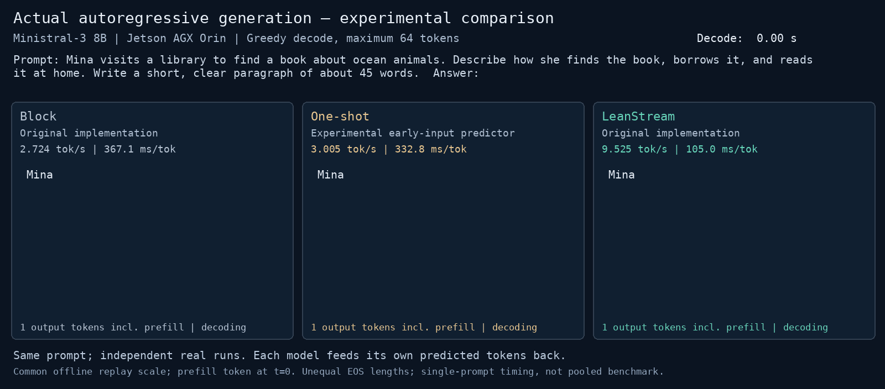

# LeanStream

**LeanStream** is the open-source implementation of our paper accepted at **ACM MobiCom 2026** ([Paper on arXiv](https://arxiv.org/abs/2609.03079)).

LeanStream is a runtime toolkit for efficient on-device LLM inference through dynamic weight prediction, SSD weight streaming, and GPU computation overlap.

## 1. Dynamic Weight / I/O Manager

`Runtime` / `LayerStep`, `WeightManager`, `ExecutionQueue`, and STREAM_IO manage logical group residency, speculative SSD reads, immediate priority refinements, final membership, and ready descriptors. New predictor generations reorder unstarted reads; inflight reads are non-preemptive. Finalization freezes execution membership. Prediction and I/O completion publish state; they do not launch GPU computation.

Public headers: `include/leanstream/{runtime,weight_manager,execution_queue,types,group_layout}.h`. Implementation: `src/runtime/` and `src/io/`. Predictor policy and GPU compute remain replaceable through ordered group IDs and `ComputeBackend`.

## 2. GPU Streaming Computation and Kernel Selection

The **production Triton backend** is in `backends/triton/`. It includes the validated sparse INT4 resident A kernel, ready-pair persistent B consumer, compact reduction, and native CUDA-driver enqueue. The validated Jetson AGX Orin production configuration uses **32 persistent B CTAs and four warps per CTA**. For the included Ministral example, A uses 610 CTAs and reduction uses 128 CTAs. These grids follow that model's geometry, not a universal model requirement.

The **CUDA reference backend** remains in `kernels/streaming_mlp.{cu,cuh}` with standalone numerical and queue examples. Its four-worker fallback uses 256 threads per CTA. Its worker configurations must not be substituted for the production Triton geometry. Production throughput evidence does not measure the standalone CUDA implementation.

`KernelSelector` consumes an offline decision table in O(1). **No online kernel profiling, candidate benchmarking, trial search, or decode-time autotuning occurs.** Production defaults to its validated 32-CTA configuration when no measured table is supplied. The synthetic example LUT is demonstration data and is never loaded automatically by the production backend.

## 3. CPU Weight Predictor

`predictor/predictor_cpu.cpp` and `include/leanstream/predictor.h` expose the reference `ls_create`, `ls_predict`, `ls_predict_subset`, and `ls_destroy` C ABI. Its scoring and quantization mathematics are preserved. A different predictor can supply ordered logical group IDs to `update_prediction` without changing I/O or GPU code.

## Architecture

```text
hidden/intermediate state -> replaceable predictor
                                   |
                            ranked logical groups
                                   v
                          WeightManager <----> SSD / dynamic I/O
                                   |
                        ExecDesc + ready queue
                                   v
                     ComputeBackend.enqueue
                                   ^
latest available caller I/O state -> bucket -> offline LUT -> candidate
                                   |
                     pre-enqueued A -> persistent B -> reduction
```

Select and submit GPU work before it needs to execute. Use the latest cheap state already available at submission; never wait for a newer predictor or I/O snapshot merely to choose a kernel. The Runtime boundary does not expose an exact constant-time remaining-required-I/O counter; callers supply state or use the backend default.

## Quick Start

CPU examples require no model checkpoint:

```sh
cmake -S . -B build -DCMAKE_BUILD_TYPE=Release
cmake --build build -j2
ctest --test-dir build --output-on-failure
./build/predictor_example
./build/kernel_selection_example
python3 tests/run_io_example.py ./build/dynamic_io_example dynamic
```

## Build

Linux, C++17, CMake 3.18+, and pthreads are required. The reference predictor also uses OpenMP; ARM builds require ARMv8.2 FP16/dot-product instructions.

```sh
# I/O/runtime only, without OpenMP or the CPU predictor:
cmake -S . -B build-io -DLEANSTREAM_PREDICTOR=OFF
cmake --build build-io -j2

# Production native Triton support; Triton/PyTorch are Python dependencies:
cmake -S . -B build-triton -DLEANSTREAM_TRITON=ON -DLEANSTREAM_PREDICTOR=OFF
cmake --build build-triton -j2

# Optional CUDA reference examples, selecting the GPU architecture:
cmake -S . -B build-cuda -DLEANSTREAM_CUDA=ON -DCMAKE_CUDA_COMPILER=/usr/local/cuda-11.8/bin/nvcc -DCMAKE_CUDA_ARCHITECTURES=87
cmake --build build-cuda -j2
```

See [production Triton](docs/triton_backend.md) for Python dependencies and native binding. The optional [Ministral recipe](examples/ministral/README.md) builds the public production path with user-provided model, packed weights, and calibrated predictors. It requires no private source tree or repository history.

## Examples

- [Dynamic I/O](examples/dynamic_io/README.md): immediate priority refinement and final consumption.
- [CPU predictor](examples/predictor/README.md): synthetic create/predict/destroy.
- [LUT interface](examples/kernel_selection/README.md): synthetic table decisions without benchmarking.
- [CUDA reference](examples/persistent_consumer/README.md): streaming arithmetic, readiness, and reduction.
- [Integrated CUDA reference](examples/end_to_end/README.md): synthetic predictor/I/O/compute integration.
- [Production Triton smoke](docs/triton_backend.md): model-independent native pre-enqueue and numerical checks.
- [Optional Ministral](examples/ministral/README.md): short real-model decode and numerical checks.

## Kernel Selection

The flow is offline characterization -> offline table synthesis -> latest I/O state -> quantized bucket -> LUT[layer][bucket] -> candidate -> pre-enqueue. The table and candidate catalog belong to the backend. Triton candidates represent 4, 8, 16, or 32 persistent B CTAs; **32 is the production fallback**. Each selected CTA count requires its matching precompiled specialization. Warps per CTA remain four. CUDA reference candidates retain their independent 1/2/4/8/16-worker catalog and four-worker fallback.

`configs/example_kernel_lut.h` is synthetic and untuned. It makes no optimality or platform-performance claim. Supply a measured offline table explicitly; otherwise retain the production fallback. See [kernel selection](docs/kernel_selection.md).

## Platform Support

Production execution is validated on Jetson AGX Orin with CUDA 11.8, upstream Triton 3.1.0, and vendor PyTorch 2.1.0a0. The optional model loader uses Transformers 4.41.1. Mapped metadata/staging require integrated-device coherence and system-scope atomics. Do not assume this publication mechanism is valid for arbitrary discrete GPUs. CPU runtime tests also build on x86 Linux. See [porting](docs/porting.md) and [dependencies](docs/dependencies.md).


## Integrating LeanStream with Your PyTorch Model

The optional [PyTorch integration kit](docs/integrating_pytorch.md) lets you retain your model, choose prediction points, provide compatible predictors and packed sparse weights, and reuse LeanStream asynchronous SSD I/O and READY-driven persistent execution. Start with the runnable [tiny model example](examples/custom_pytorch/) and [custom Triton bundle guide](docs/custom_triton.md). Manual integration is tested on Jetson; automatic discovery is structural inspection, and Qwen end-to-end support requires user-provided compatible artifacts and validation. The existing Ministral integration remains independent.

## Performance Demonstration

The animation compares Block, One-shot, and LeanStream on NVIDIA Jetson AGX Orin for the same prompt. Tokens appear according to their measured completion times.



## Reproduce the Ministral-3 8B Results

The optional [reproduction guide](docs/reproduce_ministral3_8b.md) covers the pinned `cyankiwi/Ministral-3-8B-Instruct-2512-AWQ-4bit` checkpoint, exact LeanStream weights/predictors, download and SHA256 verification, native build, short numerical/decode checks, Block/One-shot/Progressive comparison, and optional fixed-500 CoQA scoring. Validated platform: Jetson AGX Orin, CUDA11.8, vendor PyTorch2.1.0a0 and Triton3.1.0. Production Triton kernel source is included in `backends/triton/`; no separate kernel download is required.

The checksummed [v2 asset collection](https://github.com/RenyuanLIU/LeanStream/releases/tag/ministral3-8b-assets-v2) includes packed weights and all predictors, including the default recalibrated One-shot. Download the pinned upstream checkpoint separately; CoQA inputs are reconstructed locally under their original terms. No training, calibration, conversion or repacking is required.

Historical v1 matched throughput (using the original512-feature One-shot) was Block **2.831**, One-shot **3.281**, LeanStream **8.877tokens/s** (approximately3.14× and2.71×). Completed public fixed-500 accuracy was **78.6953% F1 /62.4167% EM**. These are previous experiment results. [Full protocol and commands](examples/ministral/README.md).

## License

License: MIT. See [LICENSE](LICENSE). External dependency licenses are described in [dependencies](docs/dependencies.md).
